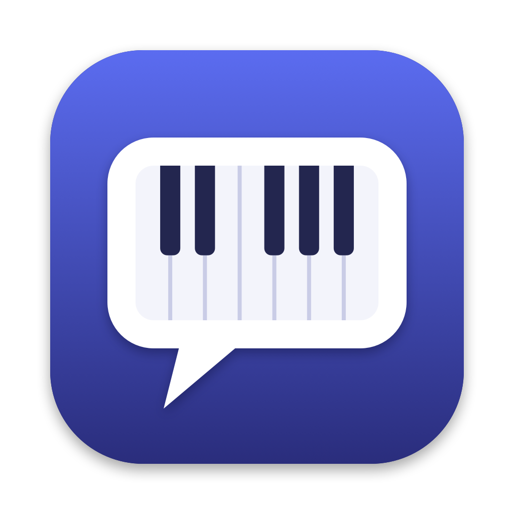

# PianoTalk



[English](README.md) | 日本語

電子ピアノ（Bluetooth MIDI）の演奏を、録音ボタンを押さなくても録音し、Claude が会話の中で録音を読んだり、フレーズをピアノで鳴らしたりできるようにするツールです。演奏へのフィードバック、楽典的な分析、続きのフレーズ提案などに使います。

録音されるのは、PianoTalk の録音デーモンが動いている間です。弾く前に PianoTalk Recorder アプリを開くか、launchd でログイン時から動かしておきます。演奏が止まって数秒たつと、1テイクとして保存されます。

- **動作環境**：macOS（CoreMIDI を使います）、Python 3.12 以上（uv が自動で入れます）、Claude デスクトップアプリまたは Claude Code
- **ピアノ**：MIDI 入出力のある電子ピアノ（Bluetooth MIDI / USB MIDI）。動作を確認した機種は Kawai CN201（Bluetooth MIDI）です。他の機種で動いた・動かなかったという報告を歓迎します。
- **プライバシー**：録音はこの Mac の `~/PianoTalk/` にだけ保存されます。Claude に渡るのは、会話の中で Claude がツールを呼んだときに返すテキスト（音名・タイミングなど）だけです。
- PianoTalk は個人が作った非公式のツールです。Anthropic、河合楽器製作所とは関係ありません。

プログラムは次の2つに分かれています。

| プログラム | 役割 |
|---|---|
| **録音デーモン** `pianotalk-recorder` | 動いている間、ピアノの演奏を録音する。ふだんは PianoTalk Recorder.app を開いて起動する。launchd でログイン時から動かしておくこともできる |
| **MCPサーバー** `pianotalk-mcp` | stdio で動く。Claude デスクトップには拡張機能（.mcpb）として入れる。Claude Code にも登録できる |

```
~/PianoTalk/
  config.toml                 設定（初回起動時に自動作成）
  recordings/YYYY-MM-DD/      録音（YYYYMMDD-HHMMSS.mid）
  recordings/kept/            保存印付き（自動削除しない）
  suggestions/                Claude が鳴らしたフレーズ
  logs/recorder.log           デーモンのログ
  playing.lock                再生中ロック（自動で作成・失効）
  recorder.json               録音デーモンの状態。MCPサーバーが読む（デーモン終了時に消える）
```

## 動作の要点

- **入力を独占しない**：CoreMIDI の入力は複数のアプリで共有できます。五線譜アプリなどと同時に使えます。
- **録音の開始と終了**：最初のノートオンで録音を始めます。全キーとサステインペダルが離れてから `silence_seconds`（既定3秒）たつと終了し、末尾の無音は保存しません。
- **記録する内容**：サステイン（CC64）、ソステヌート（CC66）、ソフト（CC67）のペダルも記録します。録音開始前からペダルを踏んでいた場合は、0秒の位置に記録します。
- **保存しない録音**：音数が `min_notes` 未満、または長さが `min_duration_seconds` 未満の録音は保存しません。
- **再生中は録音しない**：`play_notes` が鳴らしている間と、その後 `post_play_mute_seconds` の間は入力を無視します。ピアノが受信したMIDIを送り返す機種でも誤って録音しません。
- **自動再接続**：ピアノの電源オン・オフや Bluetooth の切断・再接続があっても、2秒ごとにポートを探し直して自動でつなぎ直します。
- **自動削除**：保存期間（既定30日）を過ぎた録音を、起動時と以後24時間ごとにゴミ箱へ移します。`kept/` 以下は対象外です。
- **削除の方式**：削除はすべて macOS のゴミ箱へ移す方式です。Finder の「戻す」で復元できます。
- **一時停止中・再生中の扱い**：一時停止中や再生中も、キーとペダルの押下状態だけは追い続けます。その間にキーを離しても、録音が終わらなくなることはありません。
- **録音されていないときは Claude に伝える**：録音デーモンが止まっている、一時停止中、ピアノが未接続のときは、`list_recordings` と `get_recording` の結果の冒頭にその旨の注意が付きます。Claude は古い録音を黙って読む代わりに、それをユーザーに伝えます。
- **バックグラウンドでも録音できる**：録音デーモンがバックグラウンドにいても macOS に動作を抑えられないので、いつ弾き始めても録音できます。Mac のスリープは妨げません。

## MCPツール

| ツール | 内容 |
|---|---|
| `list_recordings(limit=20)` | 新しい順に、ID（ファイル名）、日時、長さ、音数、音域、保存印を一覧する |
| `get_recording(id="latest", start_sec?, end_sec?)` | 冒頭に要約、続いて時刻順のイベントを返す。40ms 以内に鳴った音は和音として1行（音名C4形式・前の打鍵からの間隔・各音の長さとベロシティ・BPM設定時は小節:拍。打鍵が15ms以上ずれた和音には `（ずれ 32ms: G4→E4→C4）` のように弾いた順を付け、ロールや前打音がわかる）、ペダルは別行。打鍵が400回を超える録音は区間ごとの概要を返し、`start_sec`/`end_sec` で区間の詳細を読む |
| `play_notes(notes, bpm?, pedal?)` | 拍単位のノート列をピアノに送って鳴らし、`suggestions/` に .mid として保存する |
| `keep_recording(id)` | `recordings/kept/` へ移し、自動削除の対象から外す |
| `delete_recording(id)` | ゴミ箱へ移す |

`play_notes` の例:
```json
{"bpm": 90,
 "notes": [{"note": "C4", "start": 0, "duration": 1, "velocity": 80},
           {"note": "E4", "start": 1, "duration": 1},
           {"note": "C3", "start": 0, "duration": 2, "velocity": 50}],
 "pedal": [{"start": 0, "end": 2}]}
```

## セットアップ

### 1. Python 環境

[uv](https://docs.astral.sh/uv/) を使います。uv は Python 3.12 本体と依存パッケージを、このフォルダの `.venv` にまとめて入れます。

```bash
curl -LsSf https://astral.sh/uv/install.sh | env UV_NO_MODIFY_PATH=1 sh
```

```bash
git clone https://github.com/tanishi109/pianotalk.git
```

```bash
cd pianotalk && ~/.local/bin/uv sync
```

以下のコマンドはすべて、この `pianotalk` フォルダで実行します。

### 2. ピアノを接続する

Bluetooth の場合は「Audio MIDI設定」→「MIDIスタジオ」→ Bluetooth でピアノを接続します。USB の場合はケーブルでつなぐだけです。接続できたかは、次のコマンドで確認できます。

```bash
.venv/bin/pianotalk-ports
```

MIDI 機器が1台だけなら、設定は要りません（自動で選びます。IAC ドライバ、ネットワークセッション、PianoTalk 自身の仮想ポートは数えません）。複数の MIDI 機器をつないでいる場合は、`~/PianoTalk/config.toml` の `input_port` と `output_port` に、ピアノのポート名の一部（例: `"CN201"`）を書いてください。指定は部分一致で、大文字と小文字は区別しません。設定ファイルは最初の起動時に自動で作られます。先に作っておきたい場合は、`.venv/bin/pianotalk-recorder` を一度起動して Ctrl-C で止めてください。

> Bluetooth MIDI は、Mac の再起動後やピアノの電源を入れ直したあとに、自動では再接続されないことがあります。その場合は「Bluetooth設定」で「接続」を押し直してください。接続が戻れば、デーモンは自動で拾い直します。

### 3. 録音デーモンを起動する

次の2つの方法から選びます。録音デーモンは同時に1つしか動きません。すでに動いているときに別の方法で起動しても、何もせずに終わります（アプリの場合はその旨を表示します）。

#### A. PianoTalk Recorder.app（録音したいときに起動する）

```bash
./scripts/build-recorder-app.sh
```

この Mac の上でアプリをビルドし（1〜2分）、確認してから `/Applications`（書き込めなければ `~/Applications`）に置きます。弾く前に Launchpad や Spotlight から **PianoTalk Recorder** を開くと、メニューバーに鍵盤のアイコンが出ます。止めるときはメニューの「終了」を選ぶか、そのままログアウトしてください。録音中のテイクは保存してから終了します。バックグラウンドに常駐するものはありません。

アプリはこの Mac の上でビルドし、ad-hoc 署名しているので、Gatekeeper に止められず、Apple の開発者アカウントも要りません。更新するときは、リポジトリを pull してからスクリプトをもう一度実行します。

#### B. launchd（ログイン時から常に動かす）

```bash
./launchd/install.sh
```

登録すると、ログイン時に自動で起動します。異常終了したときだけ自動で再起動し、メニューの「終了」などで正常に止めた場合は止まったままです。

| やりたいこと | 方法 |
|---|---|
| 止める | メニューバーのアイコン →「終了」、または `launchctl kill TERM gui/$(id -u)/com.pianotalk.recorder` |
| 起動する | `launchctl kickstart gui/$(id -u)/com.pianotalk.recorder` |
| 再起動する（設定を変えたあと） | `launchctl kickstart -k gui/$(id -u)/com.pianotalk.recorder` |
| 録音だけ一時的に止める | メニューの「録音を一時停止」／「録音を再開」 |
| 状態を確認する | `launchctl print gui/$(id -u)/com.pianotalk.recorder \| grep -m1 "state ="` |
| ログを見る | `tail -f ~/PianoTalk/logs/recorder.log`（メニューの「ログを開く」でも開けます） |
| 自動起動をやめる・戻す | `launchctl disable gui/$(id -u)/com.pianotalk.recorder` ／ `launchctl enable …` |
| 登録を解除する | `./launchd/install.sh uninstall`（録音ファイルは残ります） |

#### メニューバーのアイコン

デーモンが起動している間は、メニューバーに鍵盤のアイコンが出ます。

| アイコン | 状態 |
|---|---|
| 鍵盤（グレー） | ピアノ未接続（接続を待っている） |
| 鍵盤 | 接続済み・待機中 |
| 鍵盤 + 赤い ● | 録音中（メニューに経過時間と音数を表示） |
| 鍵盤 + 赤い ○ | 全キーとペダルが離れ、数秒後に保存する（メニューに残り秒数。短すぎて保存しない場合もそう表示） |
| 鍵盤 + 緑の ✓ | 保存した（3秒間） |
| 鍵盤 + – | 短すぎて保存しなかった（3秒間。メニューにも理由を表示） |
| スピーカー | Claude が再生中（入力を無視） |
| 一時停止 | 録音を一時停止中 |

メニューには、最後に保存した録音（クリックすると Finder で表示）、録音の一時停止／再開、録音フォルダ、ログ、終了の項目があります。ピアノが未接続のときは「Audio MIDI 設定を開く…」も出ます。Bluetooth の接続が切れたときは、ここから MIDIスタジオを開いて接続し直してください。

#### ピアノで聴き返す

メニューの「ピアノで聴き返す ▸」に、最近の自分の録音（10件）と Claude のフレーズ（5件）が並びます。選ぶと接続中のピアノで鳴ります。

- 再生中はアイコンがスピーカーになり、メニューに経過時間と「■ 再生を停止」が出ます。長さの上限はなく、いつでも止められます。
- 再生中と直後の約1秒は録音しないので、聴き返しが新しい録音として保存されることはありません。
- ピアノが未接続のときや録音中は選べません。Claude が演奏中のときは再生せず、メニューに理由を表示します（警告音も鳴ります）。
- もっと古いファイルは「録音フォルダを開く」から探してください。

- アイコンが見当たらないときは、「システム設定 → メニューバー」で項目が非表示になっていないか確認してください（アプリの場合は「PianoTalk Recorder」、launchd で動かしている場合は「python3.12」という名前で並びます）。
- アイコンが要らない場合は、`config.toml` の `[ui] menubar = false` にして再起動します（launchd の場合だけです。アプリは、終了できるように常にアイコンを出します）。

### 4. Claude デスクトップに拡張機能をインストール

[最新のリリース](https://github.com/tanishi109/pianotalk/releases/latest)から `pianotalk-<バージョン>.mcpb` をダウンロードし、ダブルクリックします（「設定 → 拡張機能 → 詳細設定 → 拡張機能をインストール…」からでも入れられます）。Python と依存パッケージは Claude デスクトップが用意します。Mac に uv がなければ、それも自動でダウンロードします。

インストール画面に「すべてのデータへのアクセス権が付与されます」「開発者情報は Anthropic によって検証されていません」という警告が出ます。これはファイルから入れる拡張機能すべてに出る表示です。PianoTalk が読み書きするのは `~/PianoTalk/` と MIDI 機器だけで、ソースはこのリポジトリで確認できます。

自分でビルドする場合は「[拡張機能のビルド](#拡張機能のビルド)」を見てください。

### 5. Claude Code に登録（任意）

Claude Code からも使いたい場合だけ必要です。Claude デスクトップだけで使うなら手順 4 で十分なので、飛ばしてかまいません。

全プロジェクトから使えるよう、user スコープで登録します。`pianotalk` フォルダで実行してください。

```bash
claude mcp add --scope user pianotalk -- "$(pwd)/.venv/bin/pianotalk-mcp"
```

`claude` コマンドがない場合は、`~/.claude.json` の最上位にある `"mcpServers"` に次の内容を追加しても登録できます。`/path/to/pianotalk` は、clone したフォルダの絶対パス（`pwd` で表示されるもの）に置き換えます。

```json
"pianotalk": {
  "type": "stdio",
  "command": "/path/to/pianotalk/.venv/bin/pianotalk-mcp"
}
```

登録できたかは、新しいセッションで `/mcp` を開いて確認します。

## 設定（`~/PianoTalk/config.toml`）

| キー | 既定値 | 説明 |
|---|---|---|
| `midi.input_port` / `midi.output_port` | `""`（自動） | ポート名（部分一致）。空なら、MIDI機器が1台だけのときにそれを使う |
| `recording.silence_seconds` | 3.0 | 全キーとペダルを離してから録音を終えるまでの秒数 |
| `recording.bpm` | 0（未設定） | 設定すると MIDI のテンポに反映し、小節・拍を表示する |
| `recording.beats_per_bar` | 4 | 小節の拍数 |
| `recording.min_notes` / `min_duration_seconds` | 3 / 2.0 | これ未満の録音は保存しない |
| `recording.retention_days` | 30 | 保存期間（0 で自動削除しない） |
| `playback.default_bpm` | 100 | `play_notes` の BPM 省略時の値 |
| `playback.post_play_mute_seconds` | 1.0 | 再生後に入力を無視する秒数 |
| `playback.max_seconds` | 120 | 1回の再生の上限 |
| `ui.menubar` | true | メニューバーにアイコンを出す |

## 開発

### ピアノなしで試す（仮想MIDIポート）

#### 自動テスト

CoreMIDI の仮想ポートを実際に作って、次の点を確かめます。

- 録音、短い録音の破棄、ペダル中は録音が終わらないこと
- 他のアプリとのポート共有、後からポートが現れたときの再接続
- `play_notes` の送信、エコーを録音しないこと
- 全MCPツールの動作（録音されていないときの注意を含む）
- 録音デーモンが同時に1つしか動かないこと
- `.mcpb` の中身

```bash
~/.local/bin/uv run pytest -v
```

#### 手動で通しで試す

1. `~/PianoTalk/config.toml` を次のように一時的に書き換え、録音デーモンを再起動します（アプリならメニューの「終了」のあと開き直す。launchd なら `launchctl kickstart -k ...`。どちらも使っていなければ `.venv/bin/pianotalk-recorder` を別ターミナルで起動）。
   ```toml
   input_port = "PianoTalk Fake Piano"
   output_port = "PianoTalk Monitor"
   ```
2. 別のターミナルで仮想の「ピアノ」を鳴らします。演奏が終わって数秒後に `recordings/` に保存されます。
   ```bash
   .venv/bin/pianotalk-fake-piano --repeat 2
   ```
3. 別のターミナルで `.venv/bin/pianotalk-monitor` を起動したまま、Claude に「さっきの演奏を読んで、続きを弾いて」と頼みます。`play_notes` が送ったノートがモニターに表示されます。
4. 試し終わったら、`input_port` と `output_port` を元の値（自動選択なら `""`）に戻して、録音デーモンを再起動します。

### 拡張機能のビルド

```bash
.venv/bin/python scripts/build-mcpb.py
```

`dist/pianotalk-<バージョン>.mcpb` ができます。

### 実装メモ

- **App Nap 対策**：録音デーモンは `NSProcessInfo.beginActivity` で App Nap を止めています（アイドル時のスリープは妨げません）。launchd で動かす場合は `ProcessType=Interactive` も指定しています。

### 構成

```
pianotalk/config.py    設定・パス
pianotalk/midiutil.py  音名、MIDI書き出し、録音の解析とテキスト化
pianotalk/storage.py   ID解決、保存印、ゴミ箱、期限切れの掃除
pianotalk/lock.py      再生中ロック
pianotalk/presence.py  録音デーモンの状態ファイルと、そこから作る注意文
pianotalk/daemon.py    録音デーモン（+ pianotalk-ports）
pianotalk/menubar.py   メニューバーのアイコンとメニュー
pianotalk/player.py    メニューからの聴き返し（.mid をピアノで再生）
pianotalk/server.py    MCPサーバー
pianotalk/devtools.py  仮想ピアノ、モニター
launchd/install.sh     launchd 登録・解除
app/                   PianoTalk Recorder.app の py2app 設定
scripts/build-recorder-app.sh  PianoTalk Recorder.app をビルドして置く
mcpb/                  Claude デスクトップ拡張機能のマニフェストと起動スクリプト
scripts/build-mcpb.py  dist/pianotalk-<バージョン>.mcpb を作る
scripts/make-icon.py   アイコンを描く（assets/、mcpb/icon.png、app/PianoTalk.icns）
tests/                 ユニットテスト、仮想ポートの結合テスト
```

## ライセンス

[MIT License](LICENSE)
